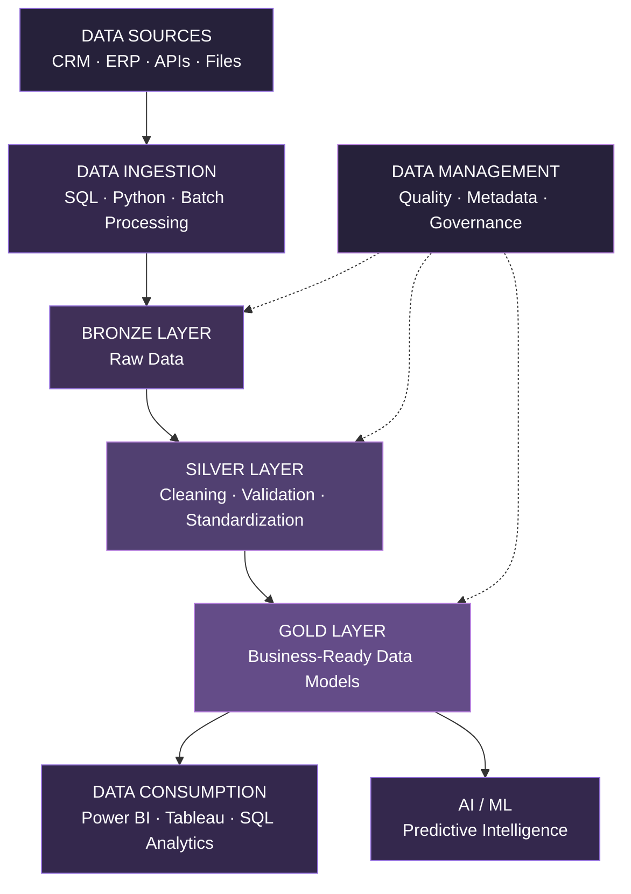

# <div align="center">Lujain Yousef</div>

<div align="center">

### Data Engineering · Data Management · Data Science

**Building reliable data foundations for intelligent, data-driven systems.**

*From raw data to trusted insights — through architecture, engineering, quality, and intelligence.*

<br>


<br>

[](https://github.com/LujainY2)
[](https://www.datacamp.com/portfolio/ylujain)

</div>

---

## 01 / The Vision

> **Data is only as valuable as the systems that make it reliable, accessible, and actionable.**

I'm a **Data Science graduate** focused on **Data Engineering and Data Management**, with a strong interest in designing structured, scalable, and trustworthy data solutions.

My work spans the data lifecycle — from ingestion and transformation to quality assurance, data modeling, warehousing, analytics, and machine learning.

I enjoy understanding not just *what the data reveals*, but **how it moves, how it is structured, how its quality is maintained, and how it can be transformed into meaningful business value.**

My core interests include:

- **Data Engineering:** Data pipelines, ETL/ELT, data integration, and transformation.
- **Data Management:** Data quality, data organization, metadata, and governance.
- **Data Architecture:** Data warehouses, dimensional modeling, and layered architectures.
- **Analytics & Intelligence:** Business intelligence, analytical reporting, and machine learning.
- **Cloud & Systems:** Cloud infrastructure, containerization, and data-driven applications.

---

## 02 / Engineering the Data Lifecycle

<div align="center">

**INGEST → VALIDATE → TRANSFORM → MODEL → SERVE → ANALYZE**

</div>



*My engineering approach prioritizes data reliability, traceability, maintainability, and analytical readiness.*

---

## 03 / Technical Ecosystem

### Data Engineering & Management

| Domain | Technologies & Concepts |
| :--- | :--- |
| **Data Engineering** | ETL · ELT · Data Pipelines · Data Integration |
| **Data Warehousing** | SQL Server · Medallion Architecture · Star Schema |
| **Data Modeling** | Dimensional Modeling · Fact & Dimension Tables |
| **Data Quality** | Validation · Cleansing · Standardization · Deduplication |
| **Data Management** | Metadata · Data Catalogs · Data Governance Concepts |
| **Data Processing** | Python · SQL · Pandas · NumPy |
| **Databases** | SQL Server · MySQL · PostgreSQL · MongoDB · Oracle SQL |

### Development, Cloud & Analytics

<div align="center">

**Programming & Data**


**Business Intelligence**


**Cloud, Backend & Development**


**AI & Machine Learning**


</div>

---

## 04 / Selected Engineering Projects

### 01 — End-to-End Sales Data Warehouse

**Data Architecture · SQL Server · CRM/ERP Integration · ETL**

[](https://github.com/LujainY2/Sales-Data-Warehouse-Using-SQL-Server)

An end-to-end data warehousing project demonstrating how operational data from multiple enterprise systems can be integrated, standardized, and transformed into structured analytical datasets.

**Architecture**

```text
CRM / ERP Source Systems
          │
          ▼
┌──────────────────────────────┐
│ BRONZE                       │
│ Raw Data Ingestion           │
│ SQL BULK INSERT              │
└──────────────┬───────────────┘
               ▼
┌──────────────────────────────┐
│ SILVER                       │
│ Data Cleaning & Validation   │
│ Standardization & Deduplication
└──────────────┬───────────────┘
               ▼
┌──────────────────────────────┐
│ GOLD                         │
│ Dimensional Data Modeling    │
│ Fact Sales                   │
│ Dim Customers / Products     │
└──────────────┬───────────────┘
               ▼
      Analytics-Ready Data
```

**Engineering highlights**

- Developed SQL-based ingestion and transformation workflows.
- Integrated CRM and ERP source datasets into a unified warehouse.
- Implemented data quality checks, cleansing, and standardization.
- Used SQL window functions to resolve duplicate customer records.
- Designed analytical fact and dimension structures using a star schema.
- Created stored procedures for repeatable Bronze and Silver loading.
- Documented schema definitions and relationships through a data catalog.

**Stack:** `SQL Server` `T-SQL` `ETL` `Data Warehousing` `Dimensional Modeling` `Data Quality`

---

### 02 — Saudi Ministry of Tourism | Data & Governance Intelligence

**Data Management · Governance · Business Intelligence · Performance Monitoring**

A tourism-sector analytics and data-management initiative supporting the organization and interpretation of performance information through reporting and dashboarding.

**Focus areas**

- Data preparation and analytical reporting.
- Data quality and governance practices.
- KPI tracking and organizational performance monitoring.
- Dashboard development and visualization.
- Transforming operational information into actionable insights.

**Stack:** `Power BI` `SQL` `Excel` `Data Governance` `Data Analytics`

---

### 03 — CyberGuard | AI-Powered Intrusion Detection System

**Machine Learning · Data Processing · Backend Integration**

[](https://github.com/LujainY2/IDS-project)

An AI-powered cybersecurity application built to detect malicious network activity through machine learning and data-driven analysis.

**System workflow**

`Network Traffic → Data Preprocessing → Feature Engineering → ML Inference → API → Interactive Analysis`

**Engineering highlights**

- Built data preprocessing and feature selection workflows.
- Trained and evaluated an XGBoost-based classification model.
- Developed a FastAPI backend for prediction requests.
- Created a Streamlit interface for model testing and exploration.
- Used Docker to containerize application components.

**Stack:** `Python` `Pandas` `XGBoost` `Scikit-learn` `FastAPI` `Streamlit` `Docker`

---

### 04 — Data Analytics & Business Intelligence Portfolio

**Data Exploration · KPI Design · Business Reporting**

[](https://github.com/LujainY2/Data-Analysis)

A collection of analytical projects focused on transforming datasets into interpretable business intelligence.

**Featured analyses**

| Project | Focus |
| :--- | :--- |
| Job Posting Analysis | Labor market trends and job demand |
| Coffee Shop Sales | Sales performance and business KPIs |
| Healthcare Analysis | Healthcare data exploration |
| Customer Churn Analysis | Customer behavior and retention |
| A/B Testing Analysis | Experiment evaluation |
| COVID-19 Vaccination | Public health data visualization |
| Ministry of Youth Strategic Plan | Strategic KPI and progress monitoring |

**Stack:** `Power BI` `Tableau` `SQL` `Python` `Data Visualization`

---

### 05 — Arabic Audio Transcription

**Speech AI · NLP · Intelligent Applications**

[](https://github.com/LujainY2/Arabic-Audio-Anime-characters-Transcribing-)

An Arabic automatic speech recognition project exploring speech-to-text processing through practical audio input interfaces.

**Stack:** `Python` `Transformers` `ASR` `Gradio`

---

## 05 / How I Think About Data

| Principle | Engineering Mindset |
| :--- | :--- |
| **Quality by Design** | Validate and standardize data before analytical consumption. |
| **Structure with Purpose** | Build data models around meaningful analytical requirements. |
| **Repeatability** | Prefer reusable, documented data transformation processes. |
| **Traceability** | Understand where data originates and how it changes. |
| **Business Alignment** | Connect technical decisions to measurable information needs. |
| **Continuous Improvement** | Refine pipelines, models, and workflows through testing and iteration. |

---

## 06 / GitHub Activity

<div align="center">


</div>

---

## 07 / Currently Exploring

```python
engineering_roadmap = {
    "Data Engineering": [
        "Pipeline Architecture",
        "ETL / ELT Optimization",
        "Data Warehousing",
        "Data Integration"
    ],
    "Data Management": [
        "Data Quality",
        "Data Governance",
        "Metadata Management",
        "Data Modeling"
    ],
    "Cloud & Analytics": [
        "Cloud Data Infrastructure",
        "Scalable Data Processing",
        "Analytical Data Systems"
    ]
}

mindset = "Design → Build → Validate → Improve"
```

---

<div align="center">

### Let's Build Better Data Systems

**Reliable Data. Thoughtful Engineering. Meaningful Intelligence.**

*Interested in opportunities across Data Engineering, Data Management, Data Warehousing, and Data Analytics.*

[](https://github.com/LujainY2)
[](https://www.datacamp.com/portfolio/ylujain)

<br>

**ENGINEER THE DATA · TRUST THE PROCESS · ENABLE INTELLIGENCE**

</div>
